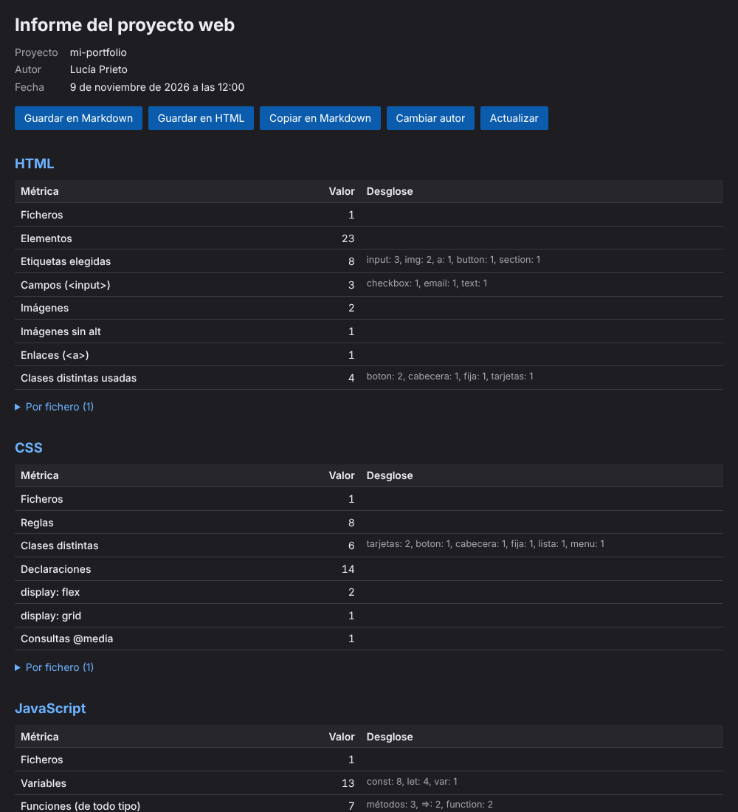
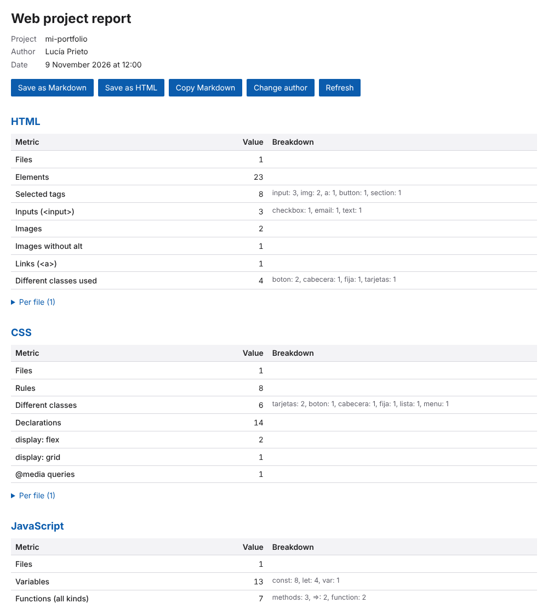

# Informe del proyecto web · Web Project Report

Extensión de VS Code que cuenta lo que elijas en los ficheros HTML, CSS y JavaScript de un proyecto y
crea un informe con autor, en español o en inglés. *English below.*



## Español

### Qué cuenta

| HTML | CSS | JavaScript |
|---|---|---|
| ficheros, líneas, elementos, etiquetas distintas, **etiquetas elegidas una a una** (`input`, `img`, `a`…), campos `<input>` (con su `type`), botones, formularios, imágenes, imágenes sin `alt`, enlaces, encabezados, elementos con `id`, clases usadas, estilos en línea, scripts, comentarios | ficheros, líneas, reglas, selectores, clases distintas, ids, declaraciones, `display: flex`, `display: grid`, `@media`, variables de CSS, `!important`, comentarios | ficheros, líneas, variables (`const`, `let`, `var`, también desestructuradas), funciones (declaradas, flecha, métodos), clases, `addEventListener`, importaciones, `console.*`, comentarios |

No cuenta lo que va en comentarios ni en cadenas: un `"display: flex"` dentro de un texto no suma. Ignora
`node_modules`, `dist`, `out`, `build` y los ficheros `.min.*`.

### Cómo se usa

1. Paleta de órdenes (`Ctrl+Mayús+P`): **Informe web: Elegir métricas y generar informe**. Marca lo que quieras
   contar; si marcas «Etiquetas elegidas», escribe cuáles (`input, img, a, button`). Se guarda en los ajustes del
   espacio de trabajo.
2. **Informe web: Indicar el autor del informe** pone tu nombre en la cabecera (se guarda en tus ajustes).
3. **Informe web: Generar informe** (o clic derecho en una carpeta del explorador) abre el informe en un panel con
   botones para guardarlo en Markdown o HTML, copiarlo, cambiar el autor o actualizarlo.

### Ajustes

| Ajuste | Para qué |
|---|---|
| `webReport.author` | autor del informe |
| `webReport.language` | `auto` (el de VS Code), `es` o `en` |
| `webReport.html.metrics`, `webReport.css.metrics`, `webReport.js.metrics` | qué contar; lista vacía = no analizar ese lenguaje |
| `webReport.html.tags` | etiquetas que se cuentan una a una |
| `webReport.perFile` | tabla con cada fichero |
| `webReport.exclude`, `webReport.ignoreMinified`, `webReport.maxFiles` | qué se deja fuera |

Ejemplo de `.vscode/settings.json`:

```json
{
  "webReport.author": "Lucía Prieto",
  "webReport.language": "es",
  "webReport.html.metrics": ["elements", "inputs", "tags"],
  "webReport.html.tags": ["input", "button", "img"],
  "webReport.css.metrics": ["classes", "displayFlex", "displayGrid"],
  "webReport.js.metrics": ["variables", "functions"]
}
```

### Desarrollo

```bash
npm install
npm test                  # analizadores, informe y traducciones (Node, sin VS Code)
npm run test:integration  # dentro de un VS Code real (en Linux sin pantalla: xvfb-run -a npm run test:integration)
npm run package           # crea informe-web-0.1.0.vsix
```

`F5` en VS Code abre una ventana de prueba con `test-fixtures/`. Instalar el `.vsix`: Extensiones → `…` →
*Instalar desde VSIX*, o `code --install-extension informe-web-0.1.0.vsix`.

Los conteos salen de un análisis léxico propio (sin dependencias): fiables con código normal, aproximados en
casos raros.

## English

A VS Code extension that counts what you choose in a project's HTML, CSS and JavaScript files and builds a report
with an author, in English or Spanish.



- **Web Report: Choose metrics and generate report**: pick what to count (elements, inputs, specific tags,
  classes, `display: flex`, `display: grid`, `@media`, variables, functions, event listeners…). Saved to the
  workspace settings.
- **Web Report: Set report author**: your name in the report header.
- **Web Report: Generate report** (or right-click a folder in the Explorer): opens the report with buttons to save
  it as Markdown or HTML, copy it, change the author or refresh it.

Settings: `webReport.author`, `webReport.language` (`auto`, `en`, `es`), `webReport.{html,css,js}.metrics` (empty
list = skip that language), `webReport.html.tags`, `webReport.perFile`, `webReport.exclude`,
`webReport.ignoreMinified`, `webReport.maxFiles`.

Comments and strings are ignored. Counts come from a dependency-free lexical analysis: reliable for ordinary code,
approximate in unusual cases.
